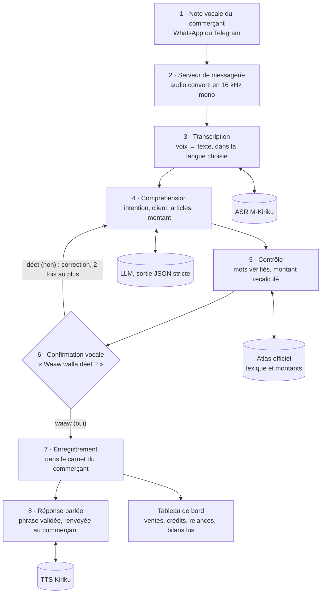

# TEWLU Kaddu

**Le carnet de compte qui se tient à la voix, en wolof, pulaar et sérère.**

TEWLU Kaddu est un assistant vocal qui tient le carnet de compte des commerçants informels du Sénégal, dans leur
langue. Le commerçant envoie une note vocale (« Awa a pris deux paquets de sucre à crédit, mille deux cents
francs ») ; Kaddu comprend, répète l'opération pour confirmation, puis l'enregistre. Chaque réponse est donnée en
texte et à voix haute.

Projet réalisé dans le cadre du Kiriku Voice Inclusive & Creative Challenge (secteur Banque & Finance).
La documentation technique complète est dans [`docs/documentation-technique.pdf`](docs/documentation-technique.pdf).

---

## Le problème

- La plupart des commerçants de quartier notent leurs ventes et leurs crédits de mémoire ou dans un cahier,
  souvent sans savoir lire le français.
- Les applications de gestion existantes sont écrites, en français, et demandent de taper des chiffres.
- Les crédits accordés aux clients (« bor », « ñamande ») sont la principale source de pertes : on oublie qui doit quoi.
- **Pas d'accès au crédit.** Les banques et les institutions de microfinance qui pourraient leur prêter n'ont aucune
  vue sur leurs ventes. Sans historique écrit, ces commerçants sont privés de crédit, même quand leur activité est
  rentable, simplement parce qu'aucun logiciel n'existe dans leur langue.

**C'est la force principale de TEWLU Kaddu :** tenu à la voix, au fil des journées, le carnet devient un historique
daté des ventes, des crédits accordés et des remboursements. Le commerçant pourra exporter ses ventes et ses revenus
depuis l'application pour appuyer une demande de crédit auprès d'une banque ou d'une IMF. C'est lui qui décide de
partager cet historique, et il peut retirer cet accès.

## Ce que fait Kaddu

| Fonction | Exemple de message | Réponse de Kaddu |
| --- | --- | --- |
| Vente au comptant ou à crédit | « Awa jënd na ñaari paket sukar, daf koo leb » | répète l'opération, demande « Waaw walla déet ? » |
| Remboursement | « Awa fey na ñaari teeméer » | confirme, puis annonce le reste dû |
| Entrée de stock | « Jend naa fukki saak ceeb » | confirme l'achat (montant facultatif) |
| Dette d'un client | « Ñaata la Awa ame ci bor ? » | « Awa daf la ameel boru … » |
| Bilan | « Lima jaay tay ci ñaata la tollu ? » | ventes du jour + total des crédits |

Les montants sont dits à la fois en français et dans la forme locale, comptée en unités de 5 F (« dërëm »).

## Langues

| Langue | Code Kaddu | Jeton ASR | Voix de réponse |
| --- | --- | --- | --- |
| Wolof | `wo` | `<\|wo\|>` | Kiriku Wolof TTS |
| Pulaar | `ff` | `<\|pu\|>` | Kiriku Pulaar TTS |
| Sérère | `srr` | `<\|se\|>` | réponse en wolof (voix wolof) |

Le sérère est compris (atlas, ASR, LLM), mais Kaddu y répond en wolof : il n'existe pas encore de voix sérère.

## Comment ça marche

Les modèles d'IA comprennent (voix → texte, texte → sens) ; le code calcule et décide (montants, états de la
conversation, écritures dans le carnet). Aucun montant enregistré ne vient directement du LLM : il est recalculé
et contrôlé par l'atlas linguistique, et rien n'est écrit sans le « waaw » (oui) du commerçant.



## Architecture

| Couche | Composant | Fichier(s) | Rôle |
| --- | --- | --- | --- |
| Canaux | WhatsApp, Telegram | `backend/` | reçoivent les notes vocales, renvoient texte + audio |
| Canaux | Interface Streamlit | `nlp/outils/revue.py`, `nlp/outils/vues/` | test, tableau de bord, revues, métriques |
| Modèles | API des modèles Kiriku | `backend/main.py` (FastAPI, port 8000) | `/asr` (voix → texte), `/tts` (texte → voix), `/models` |
| Modèles | Détection de langue (expérimental) | `nlp/detection_langue.py` | wolof / pulaar / sérère avec l'ASR lui-même |
| Modèles | Compréhension (LLM) | `nlp/outils/extraire_llm.py` | texte → JSON strict (intention, client, articles, montant) |
| Cœur | Façade Kaddu | `nlp/kaddu.py` | point d'entrée unique pour les messageries : `Kaddu.traiter()` |
| Cœur | Moteur de conversation | `nlp/pipeline.py` | machine à états, confirmations, corrections, réponses |
| Cœur | Atlas linguistique | `nlp/atlas.py`, `nlp/data/atlas/` | lexique officiel, montants, contrôle du LLM, phrases validées |
| Données | Carnets des commerçants | `nlp/stockage_json.py`, SQLite | opérations et articles, un carnet par commerçant |
| Contrats | Schémas Pydantic | `contracts/models.py` | formats d'échange vérifiés entre backend et NLP |

Principes :

- **Un seul point d'entrée.** Les messageries n'appellent que `Kaddu.traiter(numero, texte, langue)`.
- **État sérialisable.** Une conversation en cours est un dictionnaire JSON : le serveur peut redémarrer sans perdre l'opération en cours.
- **Stockage interchangeable.** Le moteur n'appelle que 5 méthodes sur le carnet : JSON, SQLite ou PostgreSQL au choix.
- **Réponses maîtrisées.** Kaddu ne génère pas ses phrases : il choisit un modèle de phrase validé par la linguiste et y insère les valeurs.

## Modèles d'IA

| Brique | Modèle | Entrée → sortie |
| --- | --- | --- |
| Reconnaissance vocale | `AIHubSN/M-Kiriku-ASR` (Whisper multilingue, jetons wo / pu / se) | audio 16 kHz → texte |
| Compréhension | LLM via API, `temperature = 0`, sortie imposée par schéma JSON | texte → JSON validé par Pydantic |
| Synthèse vocale | `AIHubSN/Kiriku-Wolof-TTS`, `AIHubSN/Kiriku-Pulaar-TTS` (VITS, Coqui TTS) | texte → WAV |
| Détection de langue (expérimental) | M-Kiriku-ASR, un pas de décodeur sur les trois jetons de langue | audio → langue et confiance |

## Utilisation depuis une messagerie

```python
from kaddu import Kaddu

kaddu = Kaddu("nlp/data/whatsapp")          # stockage JSON, expiration après 30 min d'inactivité

# à chaque note vocale reçue
texte = asr(audio, langue)                   # /asr de l'API des modèles (jeton wo, pu ou se)
r = kaddu.traiter(numero, texte, langue)     # langue : "wo", "ff" ou "srr"

envoyer_texte(numero, r["reponse"])
envoyer_audio(numero, tts(r["texte_tts"], r["voix_tts"]))
```

Le détail de l'intégration est dans [`docs/integration-kaddu.md`](docs/integration-kaddu.md).

## Installation

Prérequis : Python 3.11 (Coqui TTS 0.19 exige une version inférieure à 3.12), ffmpeg, un jeton Hugging Face
(modèles Kiriku) et une clé OpenRouter (LLM).

```bash
git clone <adresse de ce dépôt>
cd tewlu-kaddu
conda create -n kaddu python=3.11 -y && conda activate kaddu
cd backend
echo "transformers==4.46.3" > override.txt
pip install uv && uv pip install --override override.txt -r requirements.txt
cd ..
pip install streamlit requests pydantic openai pandas altair apscheduler
```

Configuration (les fichiers `.env` ne sont jamais versionnés) :

```bash
# backend/.env
HF_TOKEN=hf_xxxxxxxx

# .env (racine du projet)
OPENROUTER_API_KEY=sk-or-xxxxxxxx
```

## Lancement

```bash
# terminal 1 : API des modèles Kiriku
cd backend && uvicorn main:app --port 8000

# terminal 2 : interface
streamlit run nlp/outils/revue.py
```

Le premier appel télécharge et charge chaque modèle (quelques minutes) ; les appels suivants sont rapides.

L'interface Streamlit réunit cinq pages : **Tester Kaddu** (parler à Kaddu en vocal ou en texte),
**Tableau de bord du commerçant** (ventes, crédits, clients à relancer, bilans lus à voix haute),
**Revue des enregistrements**, **Revue des conversations** et **Métriques et données**.

Outils en ligne de commande :

| Commande | Effet |
| --- | --- |
| `python nlp/outils/importer_atlas_officiel.py` | régénère l'atlas depuis le classeur officiel |
| `python nlp/outils/donnees_demo.py` | crée le carnet de démonstration (60 jours) |
| `python nlp/outils/essai_detection.py audios/*.wav` | mesure la détection de langue sur de vrais vocaux |
| `python nlp/outils/transcrire_dossier.py` | transcrit un dossier de vocaux avec l'ASR |
| `python nlp/outils/extraire_llm.py <modèle>` | essaie la compréhension d'une phrase avec un LLM donné |

## Sécurité et confidentialité

- **Voix traitée localement** : ASR et TTS tournent sur la machine du projet ; les vocaux ne quittent pas le serveur.
- **Intégrité du carnet** : rien n'est écrit sans « oui » explicite ; aucune opération n'est effacée (statut annulée).
- **Isolation** : un carnet par numéro ; les carnets de test et de démonstration sont séparés des carnets réels.
- **Prévu en production** : chiffrement des carnets au repos, CORS restreint sur l'API des modèles, politique de
  conservation des vocaux et consentement des commerçants.

## Limites connues et suite du projet

| Limite | Effet | Contournement actuel |
| --- | --- | --- |
| Pas de voix sérère | Kaddu répond au sérère en wolof | phrases et voix wolof |
| Dépenses non ouvertes | réponse « pas encore disponible » | — |

- [ ] Export de l'historique des ventes et des revenus (« passeport financier », PDF ou tableur) que le commerçant
      partage avec une banque ou une IMF de son choix.
- [ ] Utiliser les conversations annotées pour affiner l'ASR et la consigne du LLM.
- [ ] Ajouter une voix sérère quand un modèle TTS existera.

## Équipe

| Membre | Rôle | Contribution |
| --- | --- | --- |
| Marème Diop | cheffe de projet, NLP | compréhension, atlas, moteur de conversation, interfaces, évaluation |
| Khalifa Babacar Diouf | backend | API des modèles, intégration WhatsApp et Telegram, contrats d'échange |
| Ndèye Maguette | linguiste | atlas officiel, validation des phrases et des termes |

## Références

- AI Hub Senegal, [AIHubSN/M-Kiriku-ASR](https://huggingface.co/AIHubSN/M-Kiriku-ASR),
  [AIHubSN/Kiriku-Wolof-TTS](https://huggingface.co/AIHubSN/Kiriku-Wolof-TTS) et
  [AIHubSN/Kiriku-Pulaar-TTS](https://huggingface.co/AIHubSN/Kiriku-Pulaar-TTS), Hugging Face.
- A. Radford et al., [Robust Speech Recognition via Large-Scale Weak Supervision](https://arxiv.org/abs/2212.04356), 2022 (Whisper).
- J. Kim, J. Kong, J. Son, [Conditional Variational Autoencoder with Adversarial Learning for End-to-End Text-to-Speech](https://arxiv.org/abs/2106.06103), 2021 (VITS).
- Banque mondiale, [The Global Findex Database 2025](https://www.worldbank.org/en/publication/globalfindex).
- [Coqui TTS](https://github.com/coqui-ai/TTS), [Hugging Face Transformers](https://github.com/huggingface/transformers),
  [FastAPI](https://fastapi.tiangolo.com/), [Streamlit](https://streamlit.io/), [Pydantic](https://docs.pydantic.dev/),
  [OpenRouter](https://openrouter.ai/docs).
