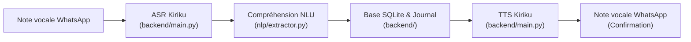

# TEWLU Kaddu

> **L'assistant vocal financier et inclusif pour les commerçants du Sénégal.**  
> *Kiriku Voice Inclusive & Creative Challenge — Track Banque & Finance.*

Compréhension vocale naturelle en **Wolof**, **Pulaar** et **Sérère** pour la tenue de caisse, le suivi des dettes et la gestion des ventes au marché.

---

## 1. Organisation du Dépôt

| Dossier | Contenu | Responsable |
|---|---|---|
| `contracts/` | Contrat d'échange Pydantic strict (`extra="forbid"`), exemples de réponses | **KBD + Marème** |
| `backend/` | API FastAPI, pipeline audio WhatsApp, ASR Whisper, TTS Coqui, BDD SQLite | **Khalifa (KBD)** |
| `nlp/` | Normalisation (nombres), moteur de règles, extraction d'entités, renfort LLM/GalsenAI | **Marème** |
| `nlp/data/` | Lexiques (`lexique.csv`), briques des nombres (`nombres.csv`), phrases de test | **Ndèye Maguette** |
| `frontend/` | Interface web / Dashboard de démo | **Équipe** |
| `docs/` | [Contrat d'API](docs/api/contrat-v1.md) · [Méthode de travail](docs/methode-de-travail.md) | **KBD + Marème** |

---

## 2. Architecture du Pipeline



---

## 3. Démarrage Rapide

### Prérequis
- Python 3.11 (recommandé pour Coqui TTS)
- Clé Hugging Face avec accès aux modèles Kiriku (`AIHubSN/M-Kiriku-ASR`, `AIHubSN/Kiriku-Wolof-TTS`...)

### Lancer le Backend
```bash
cd backend
cp .env.example .env   # Renseigner votre HF_TOKEN
# Activer votre environnement virtuel
uvicorn main:app --reload --port 8000
```

### Lancer les Tests NLP et Contrats
```bash
python -m nlp.test_nlp
pytest contracts/tests/
```
